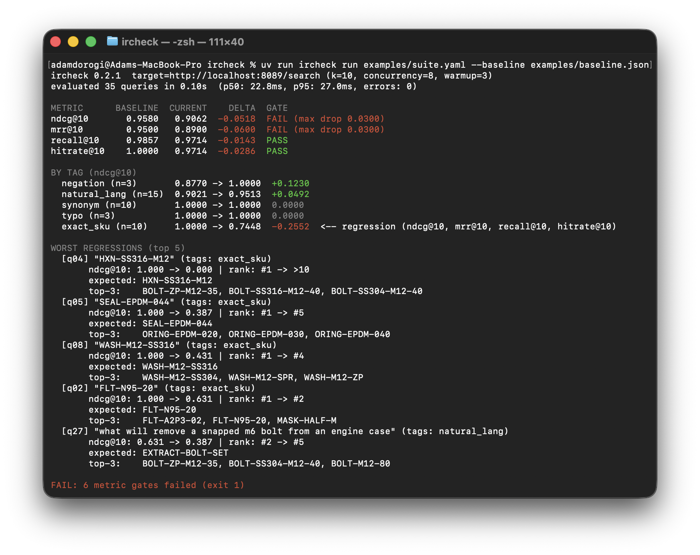

# ircheck

Small CLI for regression-testing search and RAG retrieval endpoints (`BM25`, vector
`k-NN`, hybrid `RRF`) against a golden JSONL query set. Runs queries concurrently,
scores nDCG, MRR, Recall, and HitRate at k, and compares overall and per-tag metrics
against a baseline. Reports p50 and p95 request latency.



## run the fixture

Use Python 3.12 or newer. Install the CLI with `uv tool install .`, or run it from
the checkout with `uv run`.

```sh
uv sync --locked
uv run python examples/mock_server.py  # terminal 1
uv run ircheck run examples/suite.yaml --baseline examples/baseline.json  # terminal 2
```

The committed baseline was measured with `examples/mock_server.py --mode bm25`.
The default server mode combines BM25 and a simulated dense ranking using 4:1
dense-to-lexical RRF weights. It improves natural-language rankings and pushes
the exact match for `HXN-SS316-M12` out of the first ten hits. The gate exits 1.

## suite and judgments

Run `ircheck init` for a starter suite. The sample `suite.yaml` below uses HTTP.

```yaml
dataset: queries.jsonl
k: 10
concurrency: 8
warmup: 3
timeout: 5
retries: 2
max_drop: 0.03
tag_max_drop:
  exact_sku: 0.05
fail_under:
  ndcg@10: 0.78
target:
  type: http
  url: http://localhost:8089/search
  method: POST
  query_template: {query: "$query", k: "$k"}
  id_path: results[].id
```

The dataset path is relative to the suite. Each line needs a unique ID, query, and
relevance judgments. A list gives each listed document grade 1. An object gives
graded judgments for nDCG, with grade 0 treated as irrelevant. Tags can overlap.

```jsonl
{"id":"q1","query":"HXN-SS316-M12","tags":["exact_sku"],"relevant":["HXN-SS316-M12"]}
{"id":"q2","query":"fasteners for seawater pumps","tags":["semantic"],"relevant":{"HXN-SS316-M12":3,"NUT-LOCK-M12-316":1}}
{"id":"q3","query":"saftey gogles over glasses","tags":["semantic","typo"],"relevant":["GOGGLE-OTG-CLEAR"]}
```

- `http` supports POST JSON and GET query parameters. Set `id_path` to the ID
  field in the response, for example `results[].id` or `/results/*/id`.
- `opensearch` posts `query_template` to `/<index>/_search`. Supply the
  cluster `url` and `index`. To use an ID from the source, set `id_field: _source.sku`.
- `python` calls an importable function named by `callable: package.module:search`.
  It takes the query and k, and returns ranked document IDs.

`$query` is substituted inside structured values before JSON encoding.
`$k` supplies the requested cutoff.

## save, compare, gate

```sh
ircheck run suite.yaml --save-baseline baseline.json
ircheck run suite.yaml --output current.json
ircheck diff baseline.json current.json --max-drop 0.03
ircheck run suite.yaml --tag exact_sku --concurrency 16 --fail-under ndcg@10=0.78
ircheck sweep baseline-suite.yaml candidate-suite.yaml
```

`compare` is an alias for `sweep`. Use `--json` for machine-readable output.
Compare snapshots from the same query set, judgments, and cutoff. Latency includes
work for retried requests and excludes warmup. Baseline drops gate relevance
metrics overall and by tag. `--fail-under` sets an absolute floor.

Exit 0 means the gates passed, 1 means a relevance gate failed, and 2 means a
configuration or runtime error. `--gh-summary` appends a Markdown report to
`GITHUB_STEP_SUMMARY`.

## GitHub Actions gate

With your candidate endpoint available to the runner, add a job like this.

```yaml
jobs:
  retrieval:
    runs-on: ubuntu-latest
    permissions:
      contents: read
    steps:
      - uses: actions/checkout@3d3c42e5aac5ba805825da76410c181273ba90b1 # v7.0.1
      - uses: astral-sh/setup-uv@c771a70e6277c0a99b617c7a806ffedaca235ff9 # v9.0.0
      - run: uv sync --locked
      - name: Compare with the checked-in baseline
        run: |
          uv run --locked ircheck run suite.yaml --baseline baseline.json --gh-summary
```
